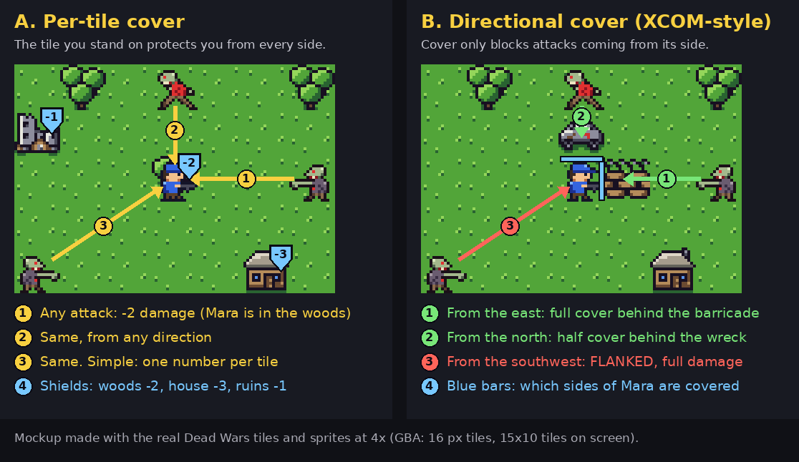

# Dead Wars: The Last Boat (design v2)

Status: **DRAFT, waiting for the owner's approval.** No code until it's approved.
Written by the engineer from the owner's design interview on 2026-10-18. The designer takes it over from here: tables, numbers and story content are theirs.
This document replaces the AW2-style direction for everything that comes next. The Part One / Part Two docs stay for reference.

---

## 0. Owner decisions (2026-10-18)

| Topic | Decision |
|---|---|
| Feel | Organ Trail journey, gritty horror. Story across time: the whole cast carries from mission to mission. |
| Units | **Individuals**, not squads. Each person has a background, personality, attributes, skills and a special ability, like Dead of Winter. Some are overpowered and some are weak. The game balances overall. |
| Info | **No telegraphed enemy intent.** Surprise matters. Damage is not luck-free: **attacks can miss**, based on the attacker's stats. |
| Cover | **Directional (XCOM-style)**. See `img/cover_options.png`, option B. |
| Turn | **Move + 1 action** per person per turn. Personalities **can override** your orders. |
| Growth | XP from kills and actions. **Skills grow from use.** |
| Gear | People carry weapons, armour and drugs (temporary buffs). **Ammo is scarce, and gunfire draws zombies.** Stealth is optional: hiding is possible, but being attacked first is bad. |
| Zombies | Keep the current types, one per tile. Later: zombie dogs, bears, bigger monsters. |
| Bitten | **Infected**: turns after a few days unless treated. |
| Buildings | **2x2 tiles, up to 4 people inside.** No interior view; the roof shows portrait badges. **Doors can be barricaded.** |
| Map | Cover from trees, walls and wrecks. Water matters (zombies can't swim). |
| Journey | **"The Last Boat"**: reach Haven Bay before the last ship sails. Food, fuel and other resources drain on a clock. Random events. Scavenge both between and during missions. **At each stop, choose one** option. |
| Vehicles | An upgradable **caravan of several cars**. Party size = the seats you have. **No vehicles on the tactical map.** |
| Missions | **Varied goals**: get through, take a bridge, hold out, rescue, retrieve, and so on. Not just "kill everything". |
| Failure | **Retreat** is allowed. **True permadeath** (one save). Everyone dead = **game over**. |
| Story | Key characters are mortal and the story adapts. A **storylet engine on the device** (RimWorld-style), built from a **relational database** so authored content can't contradict itself. No LLM in the game. |
| Extras | **Campfire Chronicle**: your run written up as a journal. |
| Difficulty | Easy / **Normal (default)** / Hard / Very Hard. |
| Search | Searching houses **never backfires** by itself. Danger comes from what's around, not from a dice roll. |
| Art | Generated formulaically, the way godot-office makes its sprites (section 14). |

---

## 1. One-sentence fantasy

**You lead a fragile caravan of survivors, people you come to know and lose, across a dying state to catch the last boat out, trading time, food and lives at every stop.**

## 2. Pillars

1. **Every person matters.** Names, faces, quirks and relationships. A death changes the group and the story.
2. **Scarcity is the clock.** Food, fuel, ammo, meds and days all drain together. Every choice spends one to save another.
3. **Quiet is safety, noise is death.** Guns solve problems now and create bigger ones in two turns.
4. **Surprise, not puzzles.** You don't know what's in the next house. Plan for it, don't solve it.
5. **Short, readable fights** on a 240x160 screen, playable in 10 to 15 minutes.

---

## 3. Structure: the journey

```
Title -> New run (difficulty, starting crew) -> JOURNEY MAP <-> STOP (choose one) -> [MISSION] -> CAMP (night) -> JOURNEY MAP ...
                                                   ^                                                           |
                                                   +-------------------- road events --------------------------+
Win: reach Haven Bay with anyone alive before the ship sails (Day 40 on Normal).  Lose: everyone dead, or the ship sails.
```

- **Route map**: a branching graph of stops, like FTL. From each stop, 2-3 next stops are shown with a region, a type icon (town, farm, gas station, outpost, hospital, bridge...), the fuel cost, the days on the road and a rumour line.
- **About 12 legs in 3 acts**:
  - Act 1: Cedar Falls and the farmland
  - Act 2: the forest highway, the river and a dead city
  - Act 3: the coast and Haven Bay
- **The horde front**: Patient Zero's horde follows the caravan on the route map. It advances every day, much like FTL's rebel fleet. Resting and detours let it catch up. Stops it has reached become siege missions.
- **At each stop, choose one**:
  - **Scavenge**: play the stop's mission.
  - **Bypass**: costs extra fuel and/or a day. No fight, no loot.
  - **Trade / Recruit**: outposts only. Swap supplies, hire people, buy or repair vehicles and upgrades.
  - **Rest**: heal, raise morale, treat infection. Costs food and a day, risks a night event, and lets the horde close in.
- **Road events** fire between stops (section 10).

## 4. The loops

| Loop | Length | What you do |
|---|---|---|
| Journey | 3-4 hours per run | Pick the route, manage the caravan and the clock, keep people alive and sane |
| Stop + camp | 2-5 min | Choose one; at night assign camp jobs; storylets fire |
| Mission | 10-15 min | Get the objective done, scavenge what you can, get out |
| Turn | 30-60 s | Each person: move, then one action. Then the horde moves, unseen where fogged |

A good 30-60 seconds: Mara slips into a house unseen and finds two cans and a pistol. Holt covers the street from behind a wreck. You hesitate over firing at the Runner, because the shot will pull the Brute two streets over. June uses her action to barricade the back door. Then the horde turn: something you didn't see comes round the side.

---

## 5. People

### 5.1 The cast (Dead of Winter style)
A pool of about **24 hand-made characters**. Each run starts with 4 (Mara, Doc, June and Holt by default, or a random four). You meet others on the road, and each run sees a random subset. **Unnamed survivors** can also join; they get a generated name, an appearance and one or two traits.

Every character has: name, background, portrait, **2 personality traits**, base attributes, starting skills, a **unique ability**, starting gear, and a few story hooks (tags used by storylets).

Draft cast (the designer owns and refines this list):

| Name | Background | Ability (draft) | Traits (draft) |
|---|---|---|---|
| Mara Quinn | Firefighter | **Carry**: moves with a downed ally; breaks doors silently | Brave, Loyal |
| Elias "Doc" Ward | ER doctor | **Surgeon**: amputation always works; heals +2 | Weary, Caring |
| June Park | Radio operator | **Scanner**: reveals the next stop's mission type and modifiers | Calm, Curious |
| Holt Becker | Ex-army sergeant | **Overwatch**: a reaction shot at the first enemy to move in sight | Hothead, Brave |
| Rosa Delgado | Mechanic | **Field repair**: fixes a vehicle at camp for half the parts | Cynic, Loyal |
| Grady Moss | Hunter | **Marksman**: no long-range penalty; crossbow expert | Loner, Calm |
| Nina Shah | Nurse | **Triage**: two heals per camp | Caring, Paranoid |
| Wade Tull | Trucker | **Road hog**: the caravan uses 1 less fuel per leg | Greedy, Optimist |
| Dana Reyes | Police officer | **Suppress**: target loses its next move | Brave, Haunted |
| Tess | Teenage runaway | **Ghost**: hidden even in the open if she didn't attack | Reckless, Selfish |
| Abe Collier | Pastor | **Rally**: removes panic in a radius; never fires guns | Devout, Pacifist |
| Lou Barros | Diner cook | **Stretch**: half rations without the penalty | Optimist, Glutton |
| Bianca Russo | Chemist | **Brew**: crafts drugs and molotovs at camp | Addict, Curious |
| Kit | 10-year-old | **Little light**: +morale; can't use guns; squeezes through windows | Brave, Fragile |
| Vic Harlan | Ex-con | **Lockpick**: opens locked caches silently | Selfish, Loyal |
| Lena Cho | Athlete | **Sprint**: +2 move once per mission | Reckless, Optimist |
| Ham Ostrowski | Farmer | **Forage**: +food from camp foraging | Calm, Stubborn |
| Iris Kahale | Electrician | **Lure**: sets a noise lure (car alarm or radio) | Paranoid, Clever |
| Boone | Biker | **Cleave**: melee hits a second adjacent zombie | Hothead, Reckless |
| Gail Fenner | Librarian | **Maps**: shows one extra route option | Calm, Cowardly |
| Ruth & Ray Abbott | Retired couple (2 people) | **Bonded**: +Aim next to each other; grief if apart | Loyal, Fragile |
| Sal Vitale | Pawnbroker | **Haggle**: better trade prices | Greedy, Cynic |
| Okafor | Teacher | **Mentor**: adjacent allies gain double skill XP | Calm, Caring |
| Cole | Bite survivor (mystery) | **Immune?**: an infection doesn't progress (a story secret tied to Patient Zero) | Haunted, Loner |

### 5.2 Attributes (1-5, fixed per person; can rarely change through events or amputation)
- **Grit**: max HP (6 + Grit), resistance to infection, and enduring hunger and cold
- **Aim**: ranged accuracy
- **Speed**: move points (2 + Speed/2 rounded up, so 3-5 tiles) and dodging melee
- **Nerve**: resists panic; affects night penalties

### 5.3 Skills (0-5, **grow from use**)
Firearms, Melee, Medicine, Mechanics, Stealth, Scavenging, Survival (cooking, foraging) and Leadership.
Each use earns skill XP: hitting a shot gives Firearms XP, a search gives Scavenging XP. A skill levels up at 10, 25, 45, 70 and 100 XP.
Kills and objectives also give **general XP**, which raises max HP by 1 every few levels and can unlock trait changes through storylets ("Holt is no longer a Hothead").

### 5.4 Personality and overrides
Each person has 2 traits from a list of about 20: Brave, Cowardly, Hothead, Calm, Loner, Loyal, Caring, Selfish, Greedy, Reckless, Paranoid, Optimist, Cynic, Devout, Addict, Haunted, Stubborn, Curious, Fragile, Glutton, Pacifist and Clever. Traits do three things:
1. **Stat quirks**: Hothead +10 to hit and -10 dodge, Calm halves night penalties, and so on.
2. **Overrides on the map.** After a **Nerve check** fails, which happens when a friend dies or is bitten, when surrounded, at night or when starving, a person may:
   - **Flee**: Cowardly. They run to the nearest exit or building.
   - **Freeze**: Fragile. They skip their turn.
   - **Berserk**: Hothead or Reckless. They charge the nearest zombie.
   - **Grab**: Greedy or Addict. They pocket loot or use a drug.
   - **Refuse to leave**: Loyal. They won't retreat without their bonded friend.

   An override shows a banner and the person's portrait. You can see a panicked person's status before you rely on them.
3. **Storylet hooks**: most story content keys off traits and relationships.

### 5.5 Relationships
Each pair of people has a value from -3 (enemies) to +3 (bonded or in love). Storylets change it ("Mara stayed with June through the fever: +1").
- Adjacent bonded allies get +10 to hit. Rivals get -10 and may argue at camp.
- A bonded friend's death means **grief**: a Nerve drop, and sometimes the Haunted trait.

### 5.6 Wounds, infection and death
- **HP** reaches 0 → the person is **downed** (bleeding out, 2 turns). An ally can stabilise them or carry them (Mara). Otherwise they **die**.
- **Wounds** (from a big hit or a downing) are -1 to a stat until healed at camp or a hospital.
- **Bitten**: each zombie melee hit has an infection chance (base 30%, lowered by armour and Grit). An **infected** person turns in **3 days (+Grit/2)**. Options at camp:
  - **Amputate** a limb, if the bite was on one. 50% of bites are. Needs Medicine 2+ or Doc. Permanent -2 Aim or -2 Speed, but cured.
  - **Antivirals**: a rare med that delays turning by 2 days.
  - **Quarantine**: tie them up and ride it out (Cole?).
  - **Mercy**: a dark storylet.
  - If nothing is done, they **turn**, at camp (a forced fight) or mid-mission.
- **Permadeath**: dead is dead. The roster keeps a **grave** with an epitaph, used by storylets and the Chronicle.

## 6. Gear, drugs, resources and clocks

### 6.1 Carried gear
Each person has a **weapon**, **armour**, and **2 pack slots** (drugs, molotovs, lockpicks, meds).

| Weapon | Range | Dmg | Acc | Noise | Ammo |
|---|---|---|---|---|---|
| Knife | melee | 2 | +10 | 1 | - |
| Bat / pipe | melee | 3 | 0 | 2 | - |
| Machete / axe | melee | 4 | 0 | 2 | - |
| Crossbow | 2-5 | 4 | +5 | 1 | bolts (recoverable) |
| Pistol | 1-4 | 3 | 0 | 6 | 1 |
| Shotgun | 1-2 | 6 | +10 | 9 | 1 |
| Hunting rifle | 2-7 | 5 | +10 | 10 | 1 |
| Molotov | 2-4 | 3 + fire | - | 5 | consumed |

Armour: a leather jacket gives -10% infection chance. Riot gear gives -25% infection chance, +1 cover vs melee and -1 move.

### 6.2 Drugs (temporary buffs; risk of addiction for Addict and Reckless)
- **Adrenaline**: +2 move this mission, then -1 Speed tomorrow.
- **Painkillers**: ignore wounds this mission.
- **Stims**: +15 to hit and -1 Nerve.
- **Sedatives**: cure panic now.
- **Antivirals**: delay turning by 2 days.

### 6.3 Caravan resources (the clock)

| Resource | Drain | Notes |
|---|---|---|
| **Food** | 1 per person per day | Rations: full, half (-morale, Grit checks) or none (starvation damage) |
| **Fuel** | Per vehicle per leg (car 2, van 3, bus 5) | Bypass costs extra. Out of fuel = abandon a vehicle and the people who don't fit |
| **Ammo** | Per shot | One shared pool. Scarce. Bolts are recoverable |
| **Meds** | Per heal or treatment | Antivirals are a separate rare item |
| **Parts** | Repairs, barricades, upgrades, crafting | |
| **Morale** | Group value 0-10 | Low morale lowers everyone's Nerve and raises desertion and fights |
| **Days** | Every leg, rest and mission | The ship sails on Day 40 (difficulty-dependent). The horde front advances every day |

**Pace** (Oregon Trail style): Careful (slower, safer events), Steady, or Hard Driving (faster, more breakdowns and exhaustion).

This is what Organ Trail did: several drains at once, choices that pick which one you sacrifice, events that hit the weakest point, a visible distance and goal, and named people slowly paying the price.

## 7. The caravan
- **Party size = total seats.** People without a seat can't come along (a hard storylet), and loot over the cargo space must be left behind.
- Vehicles: **Sedan** (4 seats, 2 cargo, fuel 2), **Pickup** (2 seats, 6 cargo, fuel 2), **Van** (6 seats, 3 cargo, fuel 3), **School bus** (12 seats, 4 cargo, fuel 5), **Motorbike** (1 seat, fuel 1, can scout ahead), **RV** (4 seats, beds that heal +1 at camp, fuel 4).
- Each vehicle has **condition** (breakdowns get likelier below 50%) and up to 2 **upgrades**: plow plating (ram through roadblocks), roof rack (+2 cargo), extra tank (+fuel), CB radio (more events: trade or rescue), sleeping cots.
- Vehicles are found in missions as an objective ("hot-wire the van"), bought at outposts, or lost to breakdowns and events.
- On the tactical map the caravan is an **extraction zone** at the map edge, not a unit.

---

## 8. Tactical rules

### 8.1 Scale and map
- **1 tile = one person's space.** Houses are **2x2** (4 tiles, 4 people). Shops and hospitals are larger (2x3, 3x3).
- Maps are about **32x24 to 48x32** tiles (MAP_MAX goes to 48x32). The screen shows 15x10 tiles.
- Terrain: road, grass, woods (half cover, hides), fences and walls (cover, block movement), wrecks (half cover), rubble, **water**, bridges, building tiles, nests.
- **Water**: zombies can't enter deep water, so rivers are defensive lines. People wade in shallows (2 MP per tile, noise 0, and they can't attack). Deep water is impassable except for a few strong swimmers, a later idea.

### 8.2 A turn
Survivors' phase: each person gets **Move** (up to their MP) **and 1 Action**, in either order, but the move can't be split. Then the horde phase.
Actions: attack, search a tile, barricade a door, heal, use an item, hide (become hidden if unseen), overwatch, carry or stabilise, interact (objective), wait.
**Personality overrides** happen at the start of that person's activation.

### 8.3 Hit chance (attacks can miss; based on who attacks)
```
ranged:  hit% = 50 + 8*Aim + 5*Firearms + weapon.acc  - cover - range_penalty - night(10, unless lit/adjacent) + flank(+15) + height(+10 rubble)
melee:   hit% = 60 + 6*Speed + 5*Melee  + weapon.acc  - target dodge(5*Speed)                               + flank(+15)
zombie:  hit% = type.base (Walker 50, Runner 60, Brute 55, Spitter 45 ranged) - target dodge - cover(ranged only) + unaware(+25)
clamped 5..95.  Damage is fixed per weapon (+1 if flanked or the target is unaware).
```
The forecast shows **hit %** and **damage** for your attacks. You never see a zombie's plan.

### 8.4 Directional cover
- Cover sits on **tile edges**, between a tile and a neighbour that holds a wall, fence, wreck, tree or building wall. It's **half (-20)** or **full (-40)**.
- It applies to a **ranged** attack if the attacker is on the far side of that edge (within 45° of the edge's normal).
- **Flanked**: the attacker is on an uncovered side. No cover applies, +15 to hit, and +1 damage.
- Melee ignores cover, but **a barricaded door or a closed window blocks melee** until it's broken (door HP).
- The UI shows blue edge bars on the selected person's tile and a red "FLANKED" tag when aiming.



### 8.5 Noise, stealth and the horde meter
- Every action makes **noise** with a radius (table in 6.1; running +2, breaking a door 4, barricading 3, a car alarm 12).
- Zombies inside the radius become **alerted**: they move toward the noise source, even through fog.
- Each noise also fills the mission's **Horde meter**. At thresholds (for example 10, 20 and 30), **waves arrive from the map edges**. This is the in-mission clock: the longer and louder you stay, the worse it gets.
- **Hidden**: a person who ends their turn in woods, inside a building or out of every zombie's sight, and hasn't attacked with a noisy weapon, is hidden. Zombies don't target hidden people unless they're adjacent or alerted to that exact tile.
- **First strike**: attacking an **unaware** target gives +25 to hit and +1 damage. Zombies get the same against unaware people: dormant zombies in a dark house, or an ambush. Getting attacked first is bad.
- **Night**: fog of war (as now), shorter sight for everyone, quieter zombies, Nerve checks. Light sources (a flashlight in a pack slot, fire) reveal tiles and also make you visible.

### 8.6 Buildings
- 2x2 footprint with one or two doors on edge tiles. **One person per tile**, so up to 4 inside.
- **No interior view.** The roof stays drawn with **portrait badges** for the people inside. Cursor on a roof → a list of who's inside.
- People inside are **hidden** unless they shoot. Shooting from a window counts as full cover on that side.
- **Barricade** a door: 1 action, 1 Parts, noise 3. Door HP is 6, and zombies must break it, which takes time and makes noise. Brutes break doors in one hit.
- **Search** each tile once: loot comes from the building type's table (house: food, meds, ammo; garage: parts, fuel; pharmacy: meds, drugs). Searching is silent and never springs a trap by itself, but **dormant zombies can be inside** (a surprise when entering).

### 8.7 Zombies
- Now: Walker, Runner, Brute, Spitter, Bloater. **One zombie per tile.** Each has HP (Walker 4, Runner 3, Brute 12, Spitter 5, Bloater 6), move, sight, hearing and an attack.
- AI: dormant → alerted (noise or sight) → hunting (pathing to the target) → attacking. Without a target they wander toward the loudest noise memory. The AI reuses the current flow-field and occupancy work.
- Later: **zombie dogs** (fast, hunt by smell, ignore hidden), **bears** (rare, terrifying, neutral until provoked), and **big monsters** (Brute variants, Patient Zero's "Hive").

## 9. Missions

### 9.1 Objective types (the "dynamic missions")

| Type | Goal | Clock / pressure |
|---|---|---|
| **Scavenge run** | Loot what you can, then extract | Horde meter waves |
| **Get through** | Get at least N people to the exit on the far side | Waves behind you; roadblocks |
| **Take the bridge** | Clear the bridge tiles, then hold them for N turns while the caravan crosses | Waves from both banks |
| **Hold out** | Survive N turns, usually at night in a barricaded building | Waves, doors failing |
| **Rescue** | Find hidden survivors in buildings, escort them to the caravan; they join you | They're panicky and slow |
| **Retrieve** | Get a specific item (antivirals for a bitten friend, a radio part, keys to the bus), then extract | Item location unknown |
| **Defend the caravan** | Keep zombies off the caravan zone for N turns while it's repaired | Constant pressure |
| **Burn the nest** | Reach and burn the nest; it makes the camp or route safer | Spawns until burned |
| **Siege** | The horde front caught you; break out or hold out | Heavy waves |
| **Boss** (later) | Patient Zero encounters | Scripted |

Missions combine **1 primary objective and 0-2 optional ones**: a cache, a stranded survivor, a vehicle to hot-wire, a fuel truck to drain.

### 9.2 Generator
A mission is **template × map × modifiers**:
- **Templates** (designer data): objective type, map tags, zombie budget, wave table, reward table.
- **Maps**: hand-made maps per region at first, later stitched from map chunks (a street block, a farm, a bridge, a gas station).
- **Modifiers**: Night, Rain (noise radius -2, sight -1), Fog, Dense horde, Dormant horde, Low on ammo, an Infected friend in the team, a Panicky VIP.

The stop's route icon shows the type. June's Scanner (or the CB radio) reveals the modifiers.

### 9.3 In-mission scavenging
Buildings and **caches** on the map (car trunks, backpacks on corpses). Loot goes to the person who searched, limited by pack space, and to the caravan's cargo on extraction.

### 9.4 Deploy, retreat and outcome
- **Deploy**: choose who goes (up to 4-6 depending on the map). The others guard the caravan; storylets may involve them.
- **Retreat**: people on the extraction zone can leave at any time. The mission ends when everyone left has extracted. People left on the map are lost: dead, or rarely found later in a storylet.
- **Failing** the primary objective costs whatever it was for (no bridge = a detour of fuel and days; no antivirals = the bite runs its course) and is never game over by itself.

## 10. Between missions

### 10.1 Camp (each night)
Assign each person **one job**:

| Job | Effect |
|---|---|
| **Cook** | Survival skill → food efficiency, morale |
| **Guard** | Prevents or weakens night raids; Nerve |
| **Repair** | Mechanics → vehicle condition, upgrades |
| **Tend** | Medicine → heal, treat infection, amputate |
| **Forage** | Scavenging and Stealth → auto-resolved scavenge for food, parts or fuel, with a risk based on skill (wounds, bites, finding a person) |
| **Scout** | Reveals the next stops' details |
| **Rest** | +HP, -exhaustion |
| **Craft** | Molotovs, barricade kits, drugs (Bianca) |

Then **storylets** fire: conversations, conflicts, confessions, romances, theft, a fever breaking, a death wish.

### 10.2 Road events (between stops)
Breakdown, roadblock, a stranger flagging you down, a trade caravan, a horde crossing the road, a gas station, a body with a backpack, an infected hitchhiker, a radio message about the boat, a bandit toll.
Each event is a storylet with choices and costs, resolved with stats ("Rosa can fix it: Mechanics 3 needed").

### 10.3 Outposts
Trade (supplies, gear, vehicles, upgrades), recruit (named or unnamed characters, who may want something in return) and rumours.

---

## 11. The storylet engine and the world-state database

**Goal:** RimWorld or Wildermyth style emergent stories, entirely in the ROM, with authored content that **can't** contradict the game state.

### 11.1 Source of truth: relational tables
Content lives as **plain-text tables** (TSV) in `deadwars/data/story/`, so it diffs and merges in git. At build time a compiler loads them into **SQLite** with **foreign keys and CHECK constraints**. Any violation fails the build.

```
var(id PK, scope{world|person|pair|vehicle}, type{bool|int|enum}, min, max, default, doc)
enum_value(enum_id FK, id, label)
trait(id PK, name, doc)          background(id PK, name)          item(id PK, kind, stats...)
character(id PK, name, background FK, trait1 FK, trait2 FK, grit, aim, speed, nerve, ability FK, portrait, tags)
storylet(id PK, phase{camp|road|stop|mission_start|mission_end|death|bite|turn|panic}, weight, once, cooldown_days, priority)
role(storylet FK, name, filter_id FK)          -- e.g. $A = alive person, trait Caring; $B = alive person, infected
condition(id, storylet FK | role FK, var FK, op{=,!=,<,<=,>,>=,has,lacks}, value, rhs_role)
choice(storylet FK, idx, label_text FK, requires FK -> condition group)
effect(storylet|choice FK, var FK, op{set,add,kill,infect,give,take,trait_add,trait_remove,rel_add,join,leave}, value, role)
text(id PK, speaker_role, body)  -- placeholders only {A.name} {B.he} {item} ...
```

### 11.2 Why contradictions are impossible
1. **Roles, not names.** A storylet never names a person directly. It declares roles with filters ("$A: alive, Caring; $B: alive, infected, rel(A,B) >= 1"), and the engine binds them to real roster members at run time. A dead person can't be bound, so a dead character can never speak or be mentioned as alive. Named-character storylets bind a role to `character = Doc` *plus* `alive`.
2. **Typed variables.** Every variable in the game is declared once in `var`, with its type and range. Conditions and effects are type-checked, and effects are range-checked (no "food = -3").
3. **Text checks.** Every placeholder must name a declared role or field, every line must fit the dialogue box (26x5), and pronoun fields come from the character table.
4. **Reachability.** The compiler's fuzzer (built on the host sim) plays thousands of random runs and reports **storylets that never fire** or fire too often, and **choices that are always unavailable**.
5. **Exclusivity.** A `once` flag, cooldowns and mutually exclusive groups (`excl_group` column) stop repeats and contradictions ("the bus burned" and "fix the bus").

### 11.3 On the device
- The compiler emits `build/gen/story.c`:
  - packed condition and effect bytecode;
  - the string table (compressed);
  - per-phase indexes;
  - the variable registry as a C enum shared with the engine.
- **State**: world vars (about 256 bytes), per-person vars (about 32 bytes x 24), a relationship matrix (24x24 s8 = 576 bytes), and storylet flags (a 4096-bit bitset = 512 bytes), all in the save.
- At each trigger point the engine:
  1. collects candidate storylets for the phase;
  2. binds roles by scanning the roster;
  3. weights the candidates;
  4. picks one with the run RNG;
  5. shows the dialogue box with portraits and choices;
  6. applies the effects;
  7. writes a **Chronicle** record.

  This is cheap: hundreds of storylets, each with a few conditions, takes well under a frame.
- **Authoring**: the designer, with help from the other sessions, writes **hundreds to thousands** of storylets as table rows. The ROM holds tens of thousands of lines easily (32 MB).

## 12. Campfire Chronicle
- The save keeps an **event log** (a ring buffer of about 4 KB of compact 4-byte records: day, event, actor, argument) covering joins, deaths, bites, amputations, kills, missions, choices and relationship changes.
- **In game**: a Journal screen at camp and a memorial on the game-over or victory screen.
- **Outside the game**: `tools/chronicle/index.html`, a static page. You drop in the `.sav` from the SD card, and it renders your run as a journal and an epitaph wall, from the same text tables. It needs no AI. Optionally, you can paste the journal into Claude for a prose retelling.

## 13. UI / HUD (240x160)

| Screen | Content |
|---|---|
| Map HUD | Top: Horde meter bar, day/night, objective tracker. Bottom panel: selected person (portrait, HP pips, status icons: infected, wounded, drugged, panicked, hidden), terrain and cover |
| Aiming | Hit % with a breakdown (Aim, cover, flank, range, night), damage, noise radius ring, "FLANKED" or "UNAWARE" tags |
| Moving | Path arrow (exists), reachable tiles, noise preview if running |
| Person sheet (R) | Stats, skills with XP bars, traits, relationships (portrait row with hearts or cracks), gear, history ("Saved June, killed 31") |
| Roof | Portrait badges; a list of who's inside |
| Journey map | Route graph, horde front, the ship date, fuel and days per option, resources strip |
| Stop | 4 big choices with costs |
| Camp | Job board with portraits; storylets in the dialogue box |
| Caravan | Vehicles, seats, cargo, condition, upgrades |
| Game over / win | Memorial wall, Chronicle summary |

## 14. Art and feel

**Direction**: gritty 16-bit horror within the GBA's 15-colour palettes:
- desaturated greens and browns by day, deep blue nights, blood red accents;
- faces that read at 16x16 on the map and 32x32 in portraits and the battle scene.

**Formulaic generation, the godot-office way.** In godot-office every robot sprite is *generated*:
- a small parametric model (signed-distance shapes in plain JS, `art/gen/robots/office.mjs`) with **one `CAST.<key>` entry per character** (head, eyes, colours, outfit, props);
- it's rendered with fixed lighting into **tone slots** (light, base, shade, dark per material), then decals, a **1-px outline**, a clean-up pass and a crop;
- the result is written as **text-grid sprite sources**, never hand-edited, deterministic, and rebuilt with one command;
- a second path (`art/gen/blender/`) renders Blender rigs at 4x and **pixelizes** them, where each 4x4 block is owned by one part, with a shared palette reduction and an outline.

For Dead Wars the artist ports the first path: a **`CAST` table** (one row per character: body type, skin, hair style and colour, outfit, colours, signature prop) → a generator → **all of a character's sprites at once**:
- the 16x16 map sprite (idle, walk and attack frames, 4 facings or 2 plus mirroring);
- the 32x32 battle figure (IDLE0/1, ATK0/1, matching today's battle contract);
- the 32x32 portrait;

all written into `art/*.txt` grids that `tools/gfx.py` already builds. New characters, and every unnamed survivor's look, are then a table row, not a drawing. Palettes are quantized to the GBA's 15 colours plus transparent per bank.

**The battle scene** (exists) becomes one person vs one zombie at a time: a close-up that suits the horror. The hit or miss shows there too.

## 15. Audio
- Music layers on the **Horde meter**: quiet ambience at 0, a pulse at the first threshold, full dread at the waves.
- Distinct noise feedback: a gunshot echo, glass, a door splintering.
- A camp theme (fragile, warm), a road theme, and a death sting per character.

## 16. Difficulty

| | Easy | **Normal** | Hard | Very Hard |
|---|---|---|---|---|
| Ship sails | Day 50 | **Day 40** | Day 36 | Day 32 |
| Starting supplies | +50% | **base** | -25% | -40% |
| Horde meter growth | x0.75 | **x1** | x1.25 | x1.5 |
| Turn time after a bite | +2 days | **base** | -1 day | -1 day, and antivirals are rarer |
| Event harshness | soft table | **standard** | harsh | brutal |

Always one save slot (ironman): an autosave at each stop and at each turn start.

## 17. Technical approach (GBA, mGBA + gpSP on Miyoo)

**Kept**:
- video, text and dialogue, sound;
- map drawing, fog, camera;
- pathfinding and the flow-field AI, with the perf work (occupancy grid);
- the info card, forecast and path arrow;
- the paced horde turn and the battle scene framework;
- the save layer;
- the art pipeline;
- the host sim (for balance and the storylet fuzzer).

**Rewritten**:
- the unit model (`Unit` → `Person` + `Zombie`);
- actions (move + 1);
- hit chance and directional cover;
- noise and stealth;
- 2x2 buildings with doors;
- objectives and the mission generator;
- the journey, stop, camp and caravan screens;
- the storylet runtime and compiler;
- the run save.

Budgets:
- **SRAM 32 KB**: profile 256 B, run state about 6 KB (roster 24x64, relationships 576, vars, flags 512, caravan, route graph), mission suspend about 10 KB (48x32 maps), Chronicle 4 KB. Two-slot A/B writes for the run, so a power-off can't wipe an ironman save.
- **CPU**: 48x32 maps are 2.5x today's maximum area. The occupancy grid and division-free BFS keep a zombie's decision under 1 frame; the target is no frame over budget on gpSP. Sight and noise checks use per-zombie radius scans, not whole-map passes.
- **ROM**: text and the storylet bytecode are compressed, so thousands of storylets fit easily.

## 18. Scope: the first playable (vertical slice)

**v1 includes**
- **Journey**: Act 1 slice, Cedar Falls → 3 stops → a river crossing, with the route map (2 choices per stop), the day clock and Pace.
- **Stops**: Scavenge, Bypass, Rest (Trade later).
- **Camp**: Cook, Guard, Tend, Forage, Rest; storylets.
- **Roster**: 6 named characters (Mara, Doc, June, Holt + 2 recruitable: Rosa, Tess) and unnamed survivors.
- **People**: attributes, skills grow from use, 2 traits, abilities for all six, relationships.
- **Overrides**: panic overrides (Flee, Freeze, Berserk).
- **Infection** with amputate, antivirals and mercy.
- **Permadeath** with graves.
- **Caravan**: 2 vehicle types (sedan, pickup), seats and cargo limits, fuel, condition.
- **Resources**: food, fuel, ammo, meds, parts, morale, days.
- **Tactics**:
  - move + 1 action, hit chance;
  - directional cover, flanking;
  - noise, hidden status and first strike;
  - the Horde meter with waves;
  - 2x2 buildings with portrait roofs, barricades and searching;
  - water;
  - night;
  - retreat and extraction.
- **Zombies**: Walker, Runner, Brute.
- **Missions**: 3 types (Scavenge run, Get through, Take the bridge) on about 4 hand-made maps, with modifiers Night and Rain.
- **Storylets**: the engine + compiler + about 40 storylets (camp, road, death, bite).
- **Rest**: difficulty modes, an ironman save, the Chronicle log in the save, and the battle scene (1v1).

**v1 does not include**
- dogs, bears or big monsters; Patient Zero and the horde front;
- outposts and trade; crafting; the full cast (24); Acts 2-3;
- the Chronicle web page; drugs beyond adrenaline and painkillers; vehicle upgrades;
- generated maps from chunks (hand-made only).

## 19. Acceptance criteria (v1)
1. A full slice run (Cedar Falls → river crossing) takes **45-75 minutes** on Normal and can be won and lost both ways (everyone dead; days run out).
2. Every mission can be completed **quietly** (melee and stealth) or **loudly** (guns), and the loud way measurably costs more: ammo plus the Horde meter.
3. Over 50 host-sim runs, the probability that a given named character dies in one slice run is between **10% and 40%**. Death happens, but not always.
4. Over 1000 fuzzed runs, at least **80% of storylets** fire at least once and none fire in more than 50% of camps. The compiler reports zero integrity errors.
5. No frame overruns on gpSP in the horde turn of the largest slice map (perf build + emu-lab).
6. Pulling the power during the autosave never loses the run (A/B slots), checked by QA.
7. On first play without explanation, the owner reads hit %, cover and noise correctly (playtest).

## 20. Team plan (after approval)

| Role | Work |
|---|---|
| **Producer** | Re-plan the roadmap around this doc. Tag the AW2-style build as "Part One classic". Decide the merge order and own releases |
| **Designer** | Owns this doc from now on: the cast table, traits, items, missions and modifiers, the resource and difficulty numbers, and storylet writing in `data/story/`. Extends the sim into the run and storylet fuzzer |
| **Engineer** | Person and zombie model, actions, hit chance, cover, noise and stealth, buildings, objectives, journey, stop, camp and caravan screens, the storylet runtime and compiler (with the designer), the save, perf |
| **Artist** | Port the godot-office generator approach: the `CAST` table → map sprite, battle figure and portrait per character; 2x2 buildings with roofs and doors; cover edge markers; status icons; the journey map and camp art |
| **Audio** | Horde-meter music layers, camp and road themes, noise SFX, death stings, a stealth ambience |
| **QA** | New smoke and playtest scripts for journey → mission → camp; gpSP perf on 48x32 maps; ironman save power-cut tests |

## 21. Open questions
1. **The old campaign**: keep the AW2-style Part One as a "Classic" mode in the same ROM, or retire it? The recommendation is to tag it as a release and retire it from the new ROM, to save code and VRAM.
2. Should the starting crew be fixed (Mara, Doc, June, Holt) or a random four from the pool?
3. Should the journey map show the horde front from Act 1, or should it appear later as a story reveal? It's not in v1 either way.
4. Romance between characters: yes or no, and how explicit (relationship +3 = "together")?
5. Naming unnamed survivors: auto-generated names only, or a name-entry screen?
6. How much of the Patient Zero mystery does Cole carry? This is designer and owner story work.
